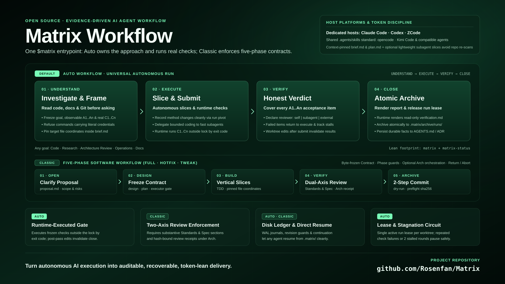

# Matrix Workflow

A general-purpose autonomous agent workflow inspired by [Comet](https://github.com/rpamis/comet), with two tiers behind one entrypoint. **Auto** lets the Agent understand a goal, decide the approach itself, and prove the result with checks the Runtime executes. **Classic** is the evidence-driven development workflow with Prim and Arch orchestration: it can work with its own capabilities or conditionally invoke a verified cohort of [Matt Pocock's agent skills](https://github.com/mattpocock/skills) without giving up lifecycle ownership.

English | **[中文](./README.zh-CN.md)**

<p align="center">
  
</p>

---

## Table of Contents

- [Why Matrix?](#why-matrix)
- [What It Does](#what-it-does)
- [Prerequisites](#prerequisites)
- [Installation](#installation)
- [Quick Start](#quick-start)
- [Auto and Classic](#auto-and-classic)
- [Workflow Phases](#workflow-phases)
- [How It Works](#how-it-works)
- [Workflow Types](#workflow-types)
- [Integration with Matt Pocock's Skills](#integration-with-matt-pococks-skills)
- [Auditing an External Skill](#auditing-an-external-skill)
- [License](#license)

---

## Why Matrix

[Matt Pocock's skills](https://github.com/mattpocock/skills) provide focused capabilities such as `/grilling`, `/tdd`, and `/code-review`. Using independent tools without a lifecycle owner leads to common problems:

- **No process memory**: You grill, then implement, but there's no record of what was decided
- **Phase confusion**: Did we finish design? Are we in build? Hard to tell after context loss
- **Silent scope creep**: Requirements change mid-build without returning to design
- **Missing evidence**: "Looks done" without verification proof

Matrix solves this with one deterministic state machine, explicit phases, guard conditions, and artifact tracking — inspired by [Comet](https://github.com/rpamis/comet)'s phase-based approach. Skills can assist a phase, but Matrix always owns the lifecycle.

---

## What It Does

One entrypoint, `$matrix`, routes every request to one of two workflows:

```
auto (default for new projects):   understand → execute → verify → close
classic full:                      open → design → build → verify → archive
classic hotfix/tweak lightweight:  open ─────────→ build → verify → archive
```

- **Auto** works for any goal, in code or outside it. The Agent investigates before asking, decides the technical approach itself, and proves the result with check commands that the Runtime executes.
- **Classic** is the evidence-driven development workflow. It has two capability-orchestration modes: **Prim**, where Matrix performs phase work itself, and **Arch**, where Matrix invokes verified atomic Skills only when task facts trigger them.

Recovery paths are controlled Runtime intents:

```text
build  --design-gap--------------------> design
verify --verification-failed-----------> build
verify --acceptance-or-design-gap------> design
any active phase --abort--------------> aborted
```

Each phase:
- Has specific deliverables (artifacts)
- Has guard conditions that must pass
- Logs all transitions
- Survives context loss (state on disk)

---

## Prerequisites

- [Claude Code](https://docs.anthropic.com/claude-code), [Codex](https://openai.com/codex), or [ZCode](https://zcode.ai) installed as the Skill host (agents that read the Agent Skills open-standard `.agents/skills` directory — opencode, Kimi Code, and other compatible tools — share the Codex installation)
- Node.js 22+ and `npm` on `PATH` (for the Matrix CLI)
- Python is optional during the compatibility window; new installations use the bundled Node workflow runtime.
- Git is only needed when installing from GitHub or contributing to Matrix.

---

## Installation

Install the Matrix CLI once:

```bash
npm install --global @rosenfan/matrix
```

Then initialize Matrix inside any project:

```bash
cd /path/to/your/project
matrix init
```

The interactive setup lets you:

- Choose English or Chinese, project or global Matrix discovery scope, and any combination of Claude Code, Codex, and ZCode
- Default to the **Auto** workflow with `balanced` autonomy, or choose **Classic** to keep the five-phase development workflow. The Matt Skills and Prim/Arch questions appear only for Classic
- Copy skills (recommended) or symlink them for local development
- Safely reconfigure an existing installation with an automatic backup
- Classic only: review all 27 official Matt Skills v1.3.1 roles and install the 25 compatible Skills into the target project
- Classic only: choose **Prim** or **Arch** as the project default without disabling the other available mode

For automation and CI:

```bash
# Safe non-interactive installation for both verified platforms: Auto workflow (the default), balanced autonomy, two Matrix Skills
matrix init --yes --platform claude-code --platform codex

# Auto, waiting for your confirmation before every Run starts executing
matrix init --yes --autonomy strict

# Classic workflow with Prim, the five phases, and all ten Matrix Skills
matrix init --yes --default-workflow classic

# Classic with the reviewed Matt Skills and Arch as the project default
matrix init --yes --default-workflow classic --with-mattpocock --default-orchestration arch

# Replace locally modified Matt Skills only after an explicit backup authorization
matrix init --yes --default-workflow classic --with-mattpocock --force-matt

# Preview exactly what would change (including backups) without writing
matrix init --platform codex --dry-run --json

# Inspect Matrix ownership, project-local Matt compatibility, and the selected platform
matrix doctor --platform codex
```

Update an initialized project:

```bash
# Check for a newer Matrix CLI, confirm the plan, then refresh this project's installed assets
matrix update

# Offline or local-development refresh: skip the npm registry and use the current CLI package
matrix update --skip-self-update

# Non-interactive update after CI has explicitly authorized writes
matrix update --yes
```

`matrix update` preserves the installation's scope, platforms, language, mode, default workflow, and orchestration. It first validates a newer npm package in isolation, then re-runs the new CLI to refresh Matrix assets. In a Classic project, when the local Matt Skills are incomplete or outdated, an interactive `matrix update` asks once and repairs them to the supported release in the same run — CLI upgrade, asset refresh, and Matt repair complete in a single command (`--with-mattpocock` gives non-interactive/CI the same behavior; `--force-matt` additionally replaces locally modified Matt Skills and requires that flag; Matt Skills are never removed by `matrix update`). `--all` extends the run to every indexed project (`~/.matrix/projects.json`); each project updates in isolation and missing directories are pruned from the index. npm and project assets are separate transactions: if asset refresh fails after a CLI upgrade, run `matrix update --skip-self-update` to retry. On Windows the self-update chain runs npm through Node (no shell), so one-command upgrades work without manual steps. An Auto project skips the Matt check: Matt Skills are optional there, and `matrix update` never installs or upgrades them on its own.

**Upgrading an existing project**: a project initialized before 0.2.0 stays on Classic after `matrix update` — the update never switches workflows — and prints the command to opt in, `matrix init --default-workflow auto`. Run `matrix init --default-workflow classic` to switch back.

Classic keeps the binding introduced in Matrix 0.1.7 to Matt Skills v1.3.1 at commit `24fe0ef7737efae15c87225755e9f6f5965e4888`. `matrix init --with-mattpocock` always uses that exact archive and its reviewed 25-Skill compatible manifest, even if upstream has a newer release. The two official but incompatible Skills, `implement` and `implement-spec`, are not Matrix-managed or installed. Matrix scope controls Matrix Skill discovery only: Matt Skills and `.matrix/matt-installation.json` are always project-local. Global Matt copies are preserved but never used to complete project readiness. Upstream v1.3.1 also renamed the domain-doc convention: Matt Skills now read `GLOSSARY.md`/`GLOSSARY-MAP.md` instead of `CONTEXT.md`/`CONTEXT-MAP.md`; rename existing files with `git mv` after updating.

Matrix ships dedicated platform entries only for agents with their own skill-directory convention: Claude Code (`.claude/skills`), Codex (`.agents/skills`), and ZCode (`.zcode/skills`). Installing the Codex platform also serves every agent that reads the Agent Skills open-standard `.agents/skills` directory by default — opencode, Kimi Code, and other compatible tools pick up Matrix and Matt Skills from there without a separate Matrix platform.

The language selected by `matrix init` controls the prose in new Matrix artifacts. Markdown headings required by Matrix guards remain stable English tokens; the artifact body is Chinese for `zh-CN` and English for `en`. A change freezes this language at creation time.

To install directly from GitHub instead of npm:

```bash
npm install --global github:Rosenfan/Matrix
```

An Auto installation installs only `matrix` and `matrix-status`; a Classic installation installs all ten:
- `matrix/` — Entry point: routes to the Auto or Classic workflow and manages state
- `matrix-open/` — Classic open phase and canonical proposal
- `matrix-design/` — Classic design, plan, and Contract approval
- `matrix-build/` — Classic bounded implementation and build evidence
- `matrix-verify/` — Classic test and two-axis review evidence
- `matrix-archive/` — Classic archive phase
- `matrix-hotfix/` — Classic shortcut for small bugs
- `matrix-tweak/` — Classic shortcut for bounded changes
- `matrix-status/` — Check current state
- `matrix-handoff/` — Classic only, optional: export to any implementation agent (Claude Code, opencode, ...)

---

## Quick Start

In Claude Code:

```
$matrix I want to add user authentication
```

In a project on the Auto workflow (the default for new installations), Matrix will:
1. Start a Run and keep the request unchanged
2. Understand: investigate the repository, docs, and Git history before asking anything, then decide the technical approach itself
3. Frame: freeze the goal, the acceptance items, and the check commands — a clear request proceeds, a vague or wide one is confirmed with you once
4. Execute and submit: the Runtime runs the frozen checks itself and records the real exit status
5. Verify and close: review on two axes with an honestly declared reviewer, then archive the Run

In a project on the Classic workflow, Matrix will:
1. Initialize a change with workflow type `full` and frozen orchestration `prim|arch`
2. Enter `open`; Prim works directly, while Arch invokes only proven requirement triggers
3. Create `proposal.md` with Goal, Scope, Non-goals, Acceptance, Risks
4. Guard check: are all sections substantive?
5. If pass → transition to `design`

---

## Auto and Classic

| | Auto | Classic |
|---|---|---|
| Phases | `understand → execute → verify → close` | `full`: `open → design → build → verify → archive`; `hotfix` and `tweak` skip design |
| Default for | new installations | projects initialized before 0.2.0 |
| Scope | any goal: code, research, architecture review, operations, documents | software development changes |
| Skills installed | `matrix`, `matrix-status` | all ten Matrix Skills |
| Matt Skills | optional; not required and not hash-checked | optional under Prim; a frozen v1.3.1 cohort under Arch |
| Proof of done | checks executed by the Runtime at `run submit`, plus a declared review source | guard conditions, Contract identity, review receipts |

In Auto, the Agent interrupts you for only three reasons: different readings of the request lead to materially different results, a fact only you hold is missing, or an irreversible or high-risk outward action comes next. Everything else — structure, libraries, test strategy — is decided by the Agent and recorded in the Run's brief.

Skills call the project's bundled Runtime directly (`node <matrix-skill-directory>/scripts/matrix-runtime.mjs <args>`); the `matrix workflow` form below reaches the same Runtime:

```bash
matrix workflow inspect
matrix workflow run start --request "<text>"
matrix workflow run frame --goal "<text>" --accept "A1=<text>" --check "C1=<command>" --expect-revision <n>
matrix workflow run submit --summary "<text>" --expect-revision <n>
matrix workflow run verify --reviewer self --result "A1=passed" --expect-revision <n>
matrix workflow run close --expect-revision <n>
```

Every command returns a `continuation` holding the exact next command. Pure questions, read-only investigations, and single-file typo fixes skip the Run entirely.

Switch workflows with `matrix init --default-workflow auto` or `matrix init --default-workflow classic`. `--autonomy <balanced|strict>` decides whether every Run waits for your confirmation before it executes.

---

## Workflow Phases

These phases belong to the Classic workflow. Auto has its own four phases; see [Auto and Classic](#auto-and-classic).

| Phase | Arch capabilities (triggered, not a fixed sequence) | Deliverables | Guard Condition |
|-------|------------------------------------------------------|--------------|-----------------|
| **open** | `/grilling`, `/domain-modeling` | `proposal.md`; optional repository-standard context/ADR evidence | Goal, Scope, Non-goals, Acceptance, Risks present |
| **design** | `/domain-modeling`, `/research`, `/prototype`, `/codebase-design`, conditional `/writing-for-agents` | `design.md`, `plan.md` | Decisions, Test seams, Steps documented |
| **build** | `/tdd`, `/diagnosing-bugs`, conditional `/writing-for-agents` and generate-only `/wizard` | Code, `verification.md` | Exact approved Contract matches; build evidence recorded |
| **verify** | `/code-review` | Test evidence, two-axis review, Arch receipt | Evidence is substantive; Arch receipt matches the current Contract, review, and workspace |
| **archive** | None; Matrix-owned in both modes | Archive record | Verify guard passed |

---

## How It Works

State is stored in `.matrix/`:

```
.matrix/
├── active.json              # Current change ID (classic)
├── current-run.json         # Run that holds the workspace lease (auto)
├── config.yaml              # default_workflow, autonomy_level, budgets
├── changes/
│   └── <change-id>/         # Classic change
│       ├── matrix.yaml      # Canonical workflow, orchestration, phase, status, revision
│       ├── workspace-baseline.json # Lightweight implementation-order boundary
│       ├── events.jsonl
│       └── artifacts/
│           ├── proposal.md
│           ├── design.md
│           ├── plan.md
│           ├── verification.md
│           └── evidence-history/
├── runs/
│   └── <run-id>/            # Auto Run
│       ├── state.json       # matrix/run/v1
│       ├── events.jsonl
│       ├── brief.md
│       ├── verification.md  # Rendered by the Runtime; read-only for the Agent
│       └── logs/            # Check output; never committed
└── archive/
    ├── <change-id>/         # Archived classic changes
    └── runs/
        └── <run-id>/        # Archived Runs
```

The Classic state machine enforces transitions:

```bash
# Check guard
matrix workflow guard open

# Advance (only if guard passes)
matrix workflow transition design

# Lightweight: approve the compact proposal and enter Build (executor choice merged into the same pause)
matrix workflow transition build --confirmed --executor <current|model|handoff:<agent-id>>

# Return from verification failure; stale evidence is retained in history
matrix workflow return build --reason verification-failed

# Abort without deleting artifacts or undoing worktree changes
matrix workflow abort --reason requirement-cancelled

# Final Archive is a mandatory two-step optimistic commit
matrix workflow archive --dry-run
matrix workflow archive --expect-preflight <sha256-returned-by-dry-run>
# hotfix/tweak commit command additionally carries --confirmed

# Diagnose an interrupted Workflow without writing
matrix workflow doctor

# Repair only the exact transaction or stale lock reported by doctor
matrix workflow doctor --repair --transaction <id> --strategy <continue|rollback>
matrix workflow doctor --repair --lock <id>
```

In Classic, `matrix.yaml` is the only canonical workflow/orchestration/phase/status/revision record, using `matrix/change/v2`. Full approval binds the exact bytes of proposal/design/plan. Lightweight approval binds the compact proposal, requires explicit confirmation, and compares the project with its initialization baseline so implementation cannot precede approval. Contract drift blocks later phases. Final Archive uses a read-only dry-run and hash-bound commit; shortcut workflows additionally require explicit confirmation. Multi-file mutations remain protected by durable journals.

---

## Workflow Types

Workflow types belong to the Classic workflow.

| Type | When to Use | Phases |
|------|-------------|--------|
| **full** | New features, architecture changes | All 5 phases |
| **hotfix** | Reproducible small bugs | Simplified: open → build → verify → archive |
| **tweak** | Bounded changes, no API/schema impact | Simplified: open → build → verify → archive |

Hotfix and tweak reference the same internal `lightweight` transition profile. They differ only in routing and evidence: hotfix requires reproduction/root-cause/regression evidence; tweak requires behavior-boundary, diff, and scope-review evidence.

---

## Special Feature: matrix-handoff

**Default usage**: Just use the main workflow (`$matrix`). Whether you're using Codex, Claude Code, zcode, or opencode, the standard flow works for all of them:

```
$matrix → open → design → build → verify → archive
```

**When to use `$matrix-handoff`**: Only in a Classic project, and only when you want to **split the work across tools** — design in one agent, implement in another.

| Scenario | What to Do |
|----------|------------|
| Use one tool for everything (default) | Just use `$matrix`, no extra steps |
| Same agent designs and implements | Standard flow: design → build → verify |
| Codex designs + Claude Code implements | design → `$matrix-handoff` → `export --agent claude-code` → Claude Code → verify |
| zcode designs + opencode implements | design → `$matrix-handoff` → `export --agent opencode` → opencode → verify |

### How matrix-handoff Works

1. Design phase completes, guard passes, and you choose the implementation agent at the Design -> Build decision point
2. Run `$matrix-handoff` → exports the frozen contract as `artifacts/handoff-task-<task-id>.md` (`export --agent <agent-id>`; `--target generic` remains as the legacy Claude Code form, `artifacts/claude-task.md`)
3. The implementation agent reads the task package and implements
4. The implementation agent produces evidence in `artifacts/verification.md`
5. Return to Matrix: build guard → verify → archive

The sidecar does NOT change Matrix state. It's a pure export — like taking a snapshot of the design for another tool to consume.

---

## Integration with Matt Pocock's Skills

This section describes the Classic workflow. In Auto, Matt Skills are optional: Matrix neither requires them nor checks their hashes, and carries the practices it relies on in its own reference docs (ADR-0005).

Prim uses Matrix's own capability. Matrix reviews all 27 official Matt v1.3.1 roles, installs the 25 compatible Skills, and lets Arch automatically invoke only this reviewed ten-capability cohort:

| Phase | Capability | Trigger |
|---|---|---|
| open | `/grilling` | Material ambiguity or explicit stress-test request |
| open/design | `/domain-modeling` | Unclear vocabulary, invariants, or architectural decisions |
| design | `/research` | Required external facts are unavailable in the repository |
| design | `/prototype` | A material design question needs disposable evidence |
| design | `/codebase-design` | A deep-module, interface, or test-seam decision remains |
| design/build | `/writing-for-agents` | The Contract changes agent-facing instructions or pointer-reached documents |
| build | `/tdd` | Observable behavior changes at a testable seam |
| build | `/diagnosing-bugs` | An actual failure exists and root cause is unknown |
| build | `/wizard` | The Contract requires generated human-run shell steps; Matrix never runs them end-to-end |
| verify | `/code-review` | Standards and Spec review evidence is required |

Matrix may recommend but never nest these user-invoked handoffs: `setup-matt-pocock-skills`, `improve-codebase-architecture`, `wayfinder`, `handoff`, `retro`, and `to-questionnaire`. The user explicitly runs them outside the active phase; selected output may enter a governed Change.

Arch records a Runtime-managed review receipt after `code-review`, binding its fixed point and committed HEAD diff to the current Contract, review evidence, and workspace. A normal `code-review` receipt requires a clean candidate worktree outside Matrix-managed assets. When Git has no usable baseline, the committed diff is empty, staged/unstaged/untracked candidate files still exist, or the correctly installed capability fails, Matrix may perform one explicitly labelled same-capability fallback for that revision. The `uncommitted-worktree` fallback binds both the fixed point and a content hash of the complete worktree candidate. Installation-integrity failures never fall back. A heading or self-description without the matching receipt cannot advance Verify.

Installed standalone Skills are `ask-matt`, `grill-with-docs`, `triage`, `to-spec`, `to-tickets`, `grill-me`, `teach`, `wait-what`, and `pr`. `implement` and `implement-spec` are incompatible because they can take over TDD/review/staging/commit effects owned by Matrix, so 0.1.7 neither installs nor manages them. Pre-existing copies (including any legacy `resolving-merge-conflicts`) are preserved and reported as unmanaged extras. Installation never grants automatic invocation, and no companion may transition, commit, archive, recover, or write Matrix state.

---

**Key difference**: Matt Pocock's skills are individual tools. Matrix adds:
- **State persistence**: Survives context loss
- **Phase enforcement**: Full cannot skip Design; lightweight cannot edit implementation before its confirmed Open Contract
- **Evidence requirements**: Guards check for artifacts, not assertions
- **Transition logging**: Full audit trail of phase changes

---

## Auditing an External Skill

Before adopting a Skill from outside Matrix, scan it for conflict risk:

```bash
# Read-only static scan; none of the Skill's scripts are executed
matrix skills audit ./path/to/skill
matrix skills audit some-skill-name
```

Matrix never installs a Skill on its own. When Auto lacks a capability, it suggests `npx skills find <keyword>` and leaves the decision to you.

---

## License

[MIT](./LICENSE)
