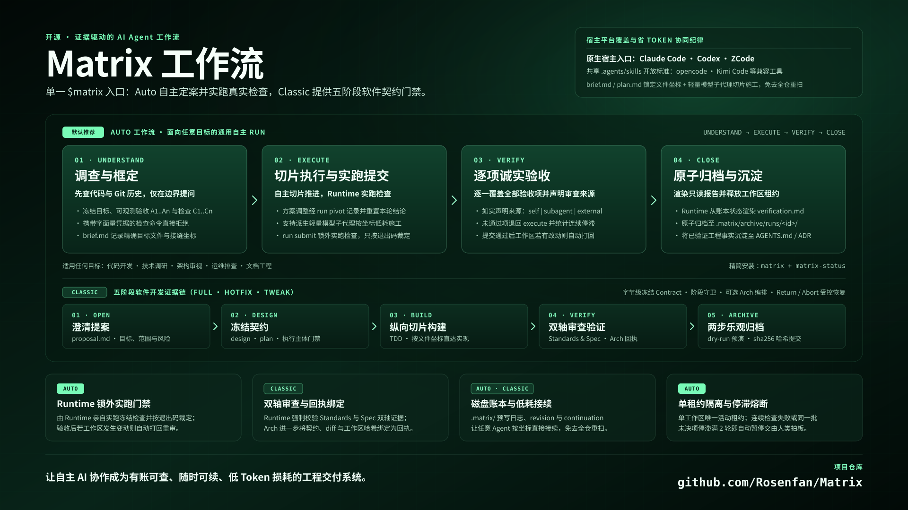

# Matrix Workflow

一个受 [Comet](https://github.com/rpamis/comet) 启发的通用自主 Agent 工作流，同一入口下提供两档。**Auto** 让 Agent 理解目标、自主决定方案，并用由 Runtime 实际执行的检查来证明结果。**Classic** 是提供 Prim 与 Arch 编排的证据驱动开发工作流：可以使用自身能力，也可以按事实调用已验证的 [Matt Pocock agent skills](https://github.com/mattpocock/skills)，但生命周期所有权始终由 Matrix 保持。

**[English](./README.md)** | 中文

<p align="center">
  
</p>

---

## 目录

- [为什么需要 Matrix](#为什么需要-matrix)
- [它做了什么](#它做了什么)
- [前置条件](#前置条件)
- [安装](#安装)
- [快速开始](#快速开始)
- [Auto 与 Classic](#auto-与-classic)
- [工作流阶段](#工作流阶段)
- [工作原理](#工作原理)
- [工作流类型](#工作流类型)
- [与 Matt Pocock Skills 的集成](#与-matt-pocock-skills-的集成)
- [审计外部 Skill](#审计外部-skill)
- [许可证](#许可证)

---

## 为什么需要 Matrix

[Matt Pocock 的 skills](https://github.com/mattpocock/skills) 提供 `/grilling`、`/tdd`、`/code-review` 等聚焦能力。但缺少统一生命周期所有者时会导致常见问题：

- **无流程记忆**：你进行了 grilling，然后实现，但没有记录决策过程
- **阶段混乱**：设计完成了吗？我们在构建阶段吗？上下文丢失后很难判断
- **静默范围蔓延**：需求在构建过程中变更，却没有返回设计阶段
- **缺少证据**："看起来完成了"却没有验证证明

Matrix 通过唯一的确定性状态机解决这些问题 —— 包含明确的阶段、守卫条件和产物追踪。Skill 可以协助阶段，但生命周期始终由 Matrix 拥有。

---

## 它做了什么

同一个入口 `$matrix` 把每个请求路由到两档工作流之一：

```
auto（新项目默认）：                understand → execute → verify → close
classic full：                     open → design → build → verify → archive
classic hotfix/tweak lightweight： open ─────────→ build → verify → archive
```

- **Auto** 适用于任何目标，改代码或不改代码都行。Agent 先调查再提问，自主决定技术方案，并用由 Runtime 实际执行的检查命令来证明结果。
- **Classic** 是证据驱动的开发工作流，提供两种能力编排：**Prim**（各阶段由 Matrix 使用自身能力）与 **Arch**（仅在任务事实满足触发条件时调用已验证的原子 Skill）。

恢复路径由 Runtime 受控执行：

```text
build  --design-gap--------------------> design
verify --verification-failed-----------> build
verify --acceptance-or-design-gap------> design
任意活动阶段 --abort-------------------> aborted
```

每个阶段：
- 有特定的交付物（产物）
- 有必须通过的守卫条件
- 记录所有转换
- 可承受上下文丢失（状态存储在磁盘上）

---

## 前置条件

- 已安装 [Claude Code](https://docs.anthropic.com/claude-code)、[Codex](https://openai.com/codex) 或 [ZCode](https://zcode.ai) 之一，作为 Skill 宿主（默认读取 Agent Skills 开放标准 `.agents/skills` 目录的 agent（如 opencode、Kimi Code 等兼容工具）直接共享 Codex 平台的安装产物）
- Node.js 22+，且 `npm` 已加入 PATH（用于 Matrix CLI）
- Python 仅在兼容窗口内的旧适配器路径使用；新安装使用内置 Node workflow runtime
- Git 仅在从 GitHub 安装或参与 Matrix 开发时需要

---

## 安装

只需全局安装一次 Matrix CLI：

```bash
npm install --global @rosenfan/matrix
```

之后在任意项目中初始化：

```bash
cd /path/to/your/project
matrix init
```

交互式初始化支持：

- 选择 Matrix Skill 发现入口安装到当前项目或全局
- 默认使用 **Auto** 工作流与 `balanced` 自治级别；也可以选择 **Classic** 保留五阶段开发工作流。Matt Skills 与 Prim/Arch 的提问只在 Classic 下出现
- 复制 skills（推荐）或为本地开发创建符号链接
- 安全地重新配置已有安装，并自动备份被替换的 Matrix 文件
- 仅 Classic：审查 Matt Skills v1.3.1 官方 27 项角色，并在目标项目安装其中 25 项兼容 Skill
- 仅 Classic：选择 Prim 或 Arch 作为项目默认值，且不禁用另一种可用模式

自动化或 CI 环境可以使用：

```bash
# 不显示交互问题：Auto 工作流（默认）、balanced 自治级别、两个 Matrix 技能
matrix init --yes

# Auto，并在每个 Run 开始执行前等待你的确认
matrix init --yes --autonomy strict

# Classic 工作流（Prim），包含五个阶段与全部十个 Matrix 技能
matrix init --yes --default-workflow classic

# Classic，安装经过审查的 Matt Skills，并以 Arch 作为项目默认编排
matrix init --yes --default-workflow classic --with-mattpocock --default-orchestration arch

# 只有明确授权备份后才替换被本地修改的 Matt Skills
matrix init --yes --default-workflow classic --with-mattpocock --force-matt

# 检查安装完整性和运行环境
matrix doctor
```

更新已经初始化的项目：

```bash
# 检查新版 Matrix CLI，确认计划后更新 CLI 并同步当前项目资产
matrix update

# 离线或本地开发：不访问 npm registry，只用当前 CLI 同步资产
matrix update --skip-self-update

# 已在自动化中明确授权写入
matrix update --yes
```

`matrix update` 会保留既有安装的 scope、平台、语言、mode、默认工作流与 orchestration。它先隔离验证 npm 新包，再由新 CLI 同步 Matrix 资产。在 Classic 项目中，当本地 Matt Skills 不完整或过期时，交互式 `matrix update` 会询问一次，并在同一轮把 Matt 修复到受支持 release——CLI 升级、资产刷新、Matt 修复一条命令完成（`--with-mattpocock` 为自动化/CI 提供等价的非交互行为；`--force-matt` 可额外替换被本地修改的 Matt Skills，且必须与 `--with-mattpocock` 同传；`matrix update` 绝不删除 Matt Skills）。`--all` 可将更新扩展到全部已索引项目（`~/.matrix/projects.json`），各项目隔离更新，失效目录自动从索引清理。npm 与项目资产是两个事务：若 CLI 已更新但资产同步失败，可运行 `matrix update --skip-self-update` 重试。Windows 上自升级链路经 Node 调用 npm（不经 shell），一条命令升级无需手动步骤。Auto 项目会跳过 Matt 检查：Matt Skills 在 Auto 下是可选项，`matrix update` 绝不会自行安装或升级它们。

**升级已有项目**：0.2.0 之前初始化的项目在 `matrix update` 之后仍保持 Classic——update 从不切换工作流——并提示可用于切换的命令 `matrix init --default-workflow auto`。要切回 Classic，运行 `matrix init --default-workflow classic`。

Classic 保持 Matrix 0.1.7 起对 Matt Skills v1.3.1 的绑定，commit 为 `24fe0ef7737efae15c87225755e9f6f5965e4888`。即使上游已有新版，`matrix init --with-mattpocock` 仍使用该确切 archive 与经过审查的 25 项兼容 manifest。官方角色中的 `implement` 与 `implement-spec` 不兼容，因此 Matrix 不安装也不管理它们。Matrix scope 只控制 Matrix Skill 的发现位置；Matt Skills 与 `.matrix/matt-installation.json` 始终属于目标项目。全局 Matt 副本会保留，但绝不用于补齐项目 readiness。上游 v1.3.1 同时把域文档约定改名：Matt Skills 现在读取 `GLOSSARY.md`/`GLOSSARY-MAP.md`（原 `CONTEXT.md`/`CONTEXT-MAP.md`）；升级后请用 `git mv` 跟随改名。

Matrix 只为拥有独立 skill 目录约定的 agent 内置平台条目：Claude Code（`.claude/skills`）、Codex（`.agents/skills`）与 ZCode（`.zcode/skills`）。安装 Codex 平台即同时覆盖所有默认读取 Agent Skills 开放标准 `.agents/skills` 目录的工具——opencode、Kimi Code 等兼容 agent 无需单独的 Matrix 平台条目即可使用 Matrix 与 Matt Skills。

`matrix init` 选择的语言决定新 Matrix 产物的正文语言：`zh-CN` 使用中文、`en` 使用英文。Runtime 守卫依赖的 Markdown 英文标题 token 保持不变；每个 change 在创建时冻结该语言。

也可以直接从 GitHub 安装，而不是 npm：

```bash
npm install --global github:Rosenfan/Matrix
```

Auto 安装只装 `matrix` 与 `matrix-status`；Classic 安装全部十个：
- `matrix/` — 入口：路由到 Auto 或 Classic 工作流并管理状态
- `matrix-open/` — Classic 的 Open 阶段与 canonical proposal
- `matrix-design/` — Classic 的 Design、plan 与 Contract 批准
- `matrix-build/` — Classic 的有界实现与构建证据
- `matrix-verify/` — Classic 的测试和双轴审查证据
- `matrix-archive/` — Classic 的归档阶段
- `matrix-hotfix/` — Classic 的小型 Bug 快捷方式
- `matrix-tweak/` — Classic 的有界变更快捷方式
- `matrix-status/` — 检查当前状态
- `matrix-handoff/` — 仅 Classic，可选：导出给任意实现 agent（Claude Code、opencode 等）

---

## 快速开始

在 Claude Code 中：

```
$matrix 我想给 API 添加用户认证
```

在使用 Auto 工作流（新安装的默认值）的项目中，Matrix 将会：
1. 启动一个 Run，并原样保存请求
2. 理解：先调查仓库、文档与 Git 历史，再决定技术方案
3. 框定：冻结目标、验收项与检查命令——明确的请求直接推进，模糊或范围很大的请求向你确认一次
4. 执行并提交：由 Runtime 亲自运行冻结的检查，并记录真实的退出状态
5. 验证并收尾：以如实声明的评审者做双轴评审，然后归档 Run

在使用 Classic 工作流的项目中，Matrix 将会：
1. 用工作流类型 `full` 和冻结的 `prim|arch` 编排初始化变更
2. 进入 `open`；Prim 直接处理，Arch 只调用已证明的需求触发能力
3. 创建 `proposal.md`，包含目标、范围、验收标准、风险
4. 守卫检查：所有章节是否内容充实？
5. 如果通过 → 转换到 `design`

---

## Auto 与 Classic

| | Auto | Classic |
|---|---|---|
| 阶段 | `understand → execute → verify → close` | `full`：`open → design → build → verify → archive`；`hotfix` 与 `tweak` 跳过 design |
| 默认 | 新安装 | 0.2.0 之前初始化的项目 |
| 范围 | 任何目标：代码、调研、架构审视、运维、文档 | 软件开发变更 |
| 安装的技能 | `matrix`、`matrix-status` | 全部十个 Matrix 技能 |
| Matt Skills | 可选；不要求，也不做哈希校验 | Prim 下可选；Arch 下为冻结的 v1.3.1 能力集 |
| "完成"的依据 | Runtime 在 `run submit` 实跑检查，加上声明的评审来源 | 守卫条件、Contract 身份、审查回执 |

在 Auto 下，Agent 只因三种原因打断你：对请求的不同理解会导致实质不同的结果、缺少只有你掌握的事实、下一步是不可逆或高危的对外动作。其余一切——结构、库、测试策略——由 Agent 决定并记入 Run 的 brief。

Skill 直接调用项目自带的 Runtime（`node <matrix-skill-directory>/scripts/matrix-runtime.mjs <args>`）；下面的 `matrix workflow` 形式到达的是同一个 Runtime：

```bash
matrix workflow inspect
matrix workflow run start --request "<text>"
matrix workflow run frame --goal "<text>" --accept "A1=<text>" --check "C1=<command>" --expect-revision <n>
matrix workflow run submit --summary "<text>" --expect-revision <n>
matrix workflow run verify --reviewer self --result "A1=passed" --expect-revision <n>
matrix workflow run close --expect-revision <n>
```

每条命令都返回带下一步确切命令的 `continuation`。纯问答、只读排查与单文件笔误修改完全不创建 Run。

用 `matrix init --default-workflow auto` 或 `matrix init --default-workflow classic` 切换工作流。`--autonomy <balanced|strict>` 决定是否每个 Run 在执行前都等待你的确认。

---

## 工作流阶段

这些阶段属于 Classic 工作流。Auto 有自己的四个阶段，见 [Auto 与 Classic](#auto-与-classic)。

| 阶段 | Arch 能力（按事实触发，不是固定序列） | 交付物 | 守卫条件 |
|------|----------------------------------------|--------|----------|
| **open** | `/grilling`、`/domain-modeling` | `proposal.md`；可选仓库约定的 context/ADR 证据 | 目标、范围、验收标准、风险存在 |
| **design** | `/domain-modeling`、`/research`、`/prototype`、`/codebase-design`、条件触发的 `/writing-for-agents` | `design.md`、`plan.md` | 决策、测试点、步骤已记录 |
| **build** | `/tdd`、`/diagnosing-bugs`、条件触发的 `/writing-for-agents` 与仅生成的 `/wizard` | 代码、`verification.md` | 已批准的精确 Contract 匹配，且已记录构建证据 |
| **verify** | `/code-review` | 测试证据、双轴审查、Arch 回执 | 证据内容充分；Arch 回执匹配当前 Contract、审查正文和工作区 |
| **archive** | 无；两种模式均由 Matrix 拥有 | 归档记录 | 验证守卫通过 |

---

## 工作原理

状态存储在 `.matrix/` 目录：

```
.matrix/
├── active.json              # 当前变更 ID（classic）
├── current-run.json         # 持有工作区租约的 Run（auto）
├── config.yaml              # default_workflow、autonomy_level、预算
├── changes/
│   └── <change-id>/         # classic 变更
│       ├── matrix.yaml      # 唯一 workflow、orchestration、阶段、状态与 revision 事实
│       ├── workspace-baseline.json # lightweight 的实施顺序边界
│       ├── events.jsonl
│       └── artifacts/
│           ├── proposal.md
│           ├── design.md
│           ├── plan.md
│           ├── verification.md
│           └── evidence-history/
├── runs/
│   └── <run-id>/            # auto Run
│       ├── state.json       # matrix/run/v1
│       ├── events.jsonl
│       ├── brief.md
│       ├── verification.md  # 由 Runtime 渲染，对 Agent 只读
│       └── logs/            # 检查输出，永不入库
└── archive/
    ├── <change-id>/         # 已归档的 classic 变更
    └── runs/
        └── <run-id>/        # 已归档的 Run
```

Classic 状态机强制执行转换：

```bash
# 检查守卫
matrix workflow guard open

# 推进（仅在守卫通过时）
matrix workflow transition design

# lightweight：确认紧凑 proposal 后进入 Build（执行主体选择并入同一次暂停）
matrix workflow transition build --confirmed --executor <current|model|handoff:<agent-id>>

# 验证失败时返回 Build；旧证据保留在历史目录
matrix workflow return build --reason verification-failed

# 终止变更但保留产物，不撤销工作区代码
matrix workflow abort --reason requirement-cancelled

# 最终归档强制使用两步乐观提交
matrix workflow archive --dry-run
matrix workflow archive --expect-preflight <dry-run-返回的-sha256>
# hotfix/tweak 的提交命令还必须带 --confirmed

# 只读诊断中断的 Workflow
matrix workflow doctor

# 只恢复 doctor 明确报告的 transaction 或陈旧锁
matrix workflow doctor --repair --transaction <id> --strategy <continue|rollback>
matrix workflow doctor --repair --lock <id>
```

在 Classic 中，`matrix.yaml` 仍是 workflow、orchestration、阶段、状态与 revision 的唯一事实来源。full 批准 proposal/design/plan 的精确字节；lightweight 批准紧凑 proposal，要求明确确认，并与初始化工作区基线比较，阻止先实现后补方案。Contract 漂移会阻断后续阶段。最终 Archive 仍使用只读 dry-run 与 hash-bound commit，shortcut 还要求明确确认；所有多文件 mutation 继续受持久 journal 保护。

---

## 工作流类型

工作流类型属于 Classic 工作流。

| 类型 | 使用场景 | 阶段 |
|------|----------|------|
| **full** | 新功能、架构变更 | 全部 5 个阶段 |
| **hotfix** | 可复现的小型 Bug | 简化：open → build → verify → archive |
| **tweak** | 有界变更，无 API/架构影响 | 简化：open → build → verify → archive |

hotfix 与 tweak 引用同一个内部 `lightweight` 迁移 profile，只在入口和证据上区分：hotfix 要求复现、根因、回归证据；tweak 要求行为边界、diff 与范围审查证据。

---

## 特别功能：matrix-handoff

**默认用法**：直接使用主流程即可。无论你用 Codex、Claude Code、zcode 还是 opencode，标准流程都适用：

```
$matrix → open → design → build → verify → archive
```

**何时使用 `$matrix-handoff`**：仅在 Classic 项目中，且仅当你想**跨工具拆分工作**时 —— 用一个 agent 设计，交给另一个 agent 实现。

| 场景 | 操作 |
|------|------|
| 一个工具完成所有工作（默认） | 直接用 `$matrix`，无需额外步骤 |
| 同一 agent 设计 + 实现 | 标准流程：design → build → verify |
| Codex 设计 + Claude Code 实现 | design → build（批准 Contract）→ `$matrix-handoff` → `export --agent claude-code` → Claude Code → verify |
| zcode 设计 + opencode 实现 | design → build（批准 Contract）→ `$matrix-handoff` → `export --agent opencode` → opencode → verify |

### matrix-handoff 工作原理

1. 设计阶段完成，守卫通过，并在 design→build 决策点选择实现 agent
2. 运行 `$matrix-handoff` → 导出冻结 Contract 为 `artifacts/handoff-task-<task-id>.md`（`export --agent <agent-id>`；`--target generic` 为兼容的 Claude Code 旧形态，产出 `artifacts/claude-task.md`）
3. 实现 agent 读取任务包并实现
4. 实现 agent 在 `artifacts/verification.md` 中产生证据
5. 返回 Matrix：构建守卫 → 验证 → 归档

此 sidecar 不会改变 Matrix 状态。它只是纯粹的导出 —— 就像为另一个工具拍一张设计快照。

---

## 与 Matt Pocock Skills 的集成

本节描述 Classic 工作流。在 Auto 下，Matt Skills 是可选项：Matrix 既不要求它们，也不校验其哈希，并把所依赖的工程实践放进自带的参考文档（ADR-0005）。

Prim 使用 Matrix 自身能力。Matrix 会审查 Matt v1.3.1 官方 27 项角色，安装其中 25 项兼容 Skill，但 Arch 只自动调用以下十项经过审查的能力：

| 阶段 | 能力 | 触发条件 |
|---|---|---|
| open | `/grilling` | 存在重大歧义或用户明确要求压力测试 |
| open/design | `/domain-modeling` | 词汇、不变量或架构决定不清晰 |
| design | `/research` | 仓库内无法获得必需的外部事实 |
| design | `/prototype` | 重大设计问题需要一次性实验证据 |
| design | `/codebase-design` | 深模块、接口或测试接缝决定尚未完成 |
| design/build | `/writing-for-agents` | Contract 修改 agent-facing 指令或指针可达文档 |
| build | `/tdd` | 可测试接缝上的可观察行为发生变化 |
| build | `/diagnosing-bugs` | 存在真实失败且根因未知 |
| build | `/wizard` | Contract 需要生成人工执行的 shell 步骤；Matrix 不端到端运行 |
| verify | `/code-review` | 需要 Standards 与 Spec 双轴证据 |

Matrix 可以推荐但绝不嵌套以下 user-invoked handoff：`setup-matt-pocock-skills`、`improve-codebase-architecture`、`wayfinder`、`handoff`、`retro`、`to-questionnaire`。它们由用户在活动阶段外显式运行，选中的结果可以再进入受治理 Change。

Arch 在 `code-review` 后记录由 Runtime 管理的审查回执，把 fixed point 与已提交的 HEAD diff 绑定到当前 Contract、审查正文和工作区。正常的 `code-review` 回执要求 Matrix 管理资产之外的候选工作区是干净的。无可用 Git 基线、已提交 diff 为空、仍存在 staged/unstaged/untracked 候选，或正确安装的 capability 真实失败时，Matrix 可为该 revision 执行一次明确标记的同能力 fallback；其中 `uncommitted-worktree` 会同时绑定 fixed point 与完整工作区候选的内容 hash。安装完整性失败不得 fallback。只有标题或自述、但没有匹配回执时，Verify 不能推进。

安装但保持 standalone 的 Skill 是 `ask-matt`、`grill-with-docs`、`triage`、`to-spec`、`to-tickets`、`grill-me`、`teach`、`wait-what`、`pr`。`implement` 与 `implement-spec` 可能接管 Matrix 所有的 TDD、review、stage 或 commit 副作用，因此 0.1.7 不安装也不管理它们；已有副本（含遗留的 `resolving-merge-conflicts`）会被保留并报告为未管理额外项。安装不代表自动调用；任何 companion 都不得推进、提交、归档、恢复或写 Matrix 状态。

---

**关键区别**：Matt Pocock 的 skills 是独立工具。Matrix 增加了：
- **状态持久化**：可承受上下文丢失
- **阶段强制**：full 不能跳过 Design；lightweight 不能在确认 Open Contract 前修改实现
- **证据要求**：守卫检查产物，而非断言
- **转换日志**：完整的阶段变更审计记录

---

## 审计外部 Skill

在采纳来自 Matrix 之外的 Skill 之前，可以先扫描它的冲突风险：

```bash
# 只读静态扫描；不执行该 Skill 的任何脚本
matrix skills audit ./path/to/skill
matrix skills audit some-skill-name
```

Matrix 绝不会自行安装 Skill。Auto 缺少某项能力时，会建议 `npx skills find <关键词>`，并把决定权留给你。

---

## 许可证

[MIT](./LICENSE)
